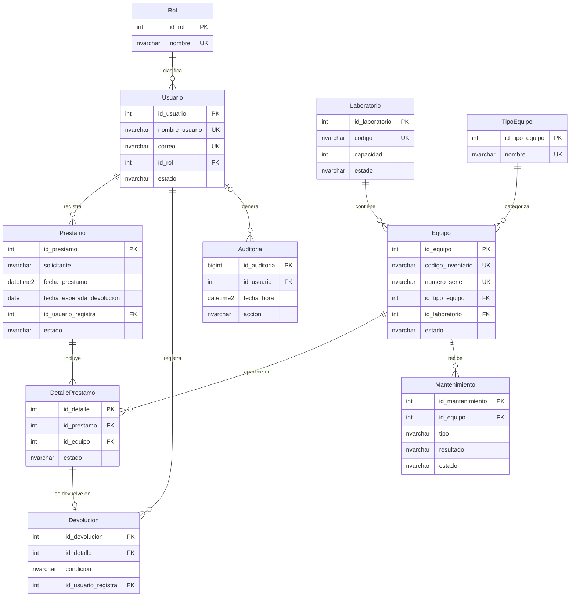

# SIGELAB – Modelo Entidad-Relación

**Cardinalidades clave**
- Laboratorio 1 : N Equipo · TipoEquipo 1 : N Equipo
- Prestamo 1 : N DetallePrestamo (mínimo 1, RN-05) · Equipo 1 : N DetallePrestamo
- DetallePrestamo 1 : 0..1 Devolucion (UNIQUE en `id_detalle`, RN-11)
- Equipo 1 : N Mantenimiento
